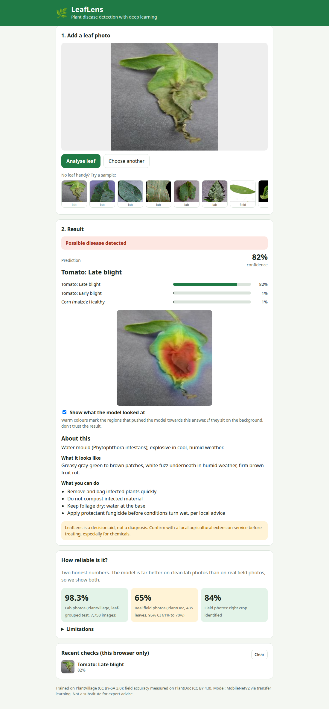
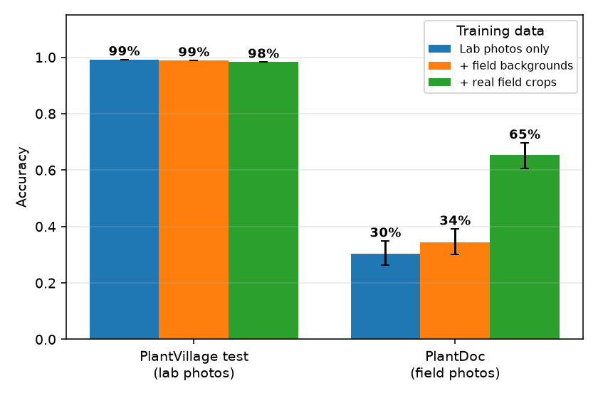
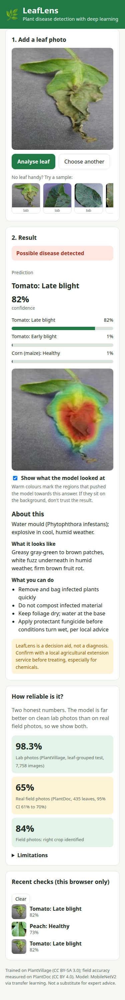
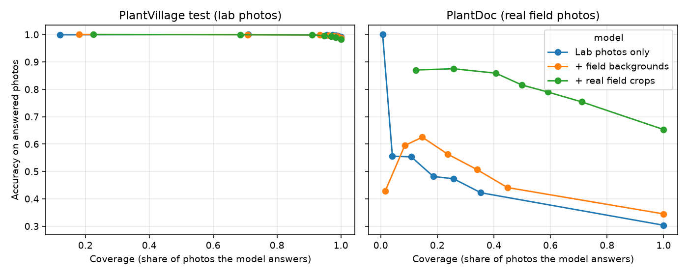

# LeafLens: plant disease detection with deep learning

Upload a photo of a leaf and LeafLens tells you which crop disease it most likely has (38 crop-disease classes across 14 crops), how sure it is, **which part of the leaf it looked at**, and what to do about it. If the model is not sure, it says so instead of guessing.

The model is a MobileNetV2 fine-tuned with transfer learning, served by a small FastAPI service (ONNX Runtime, no PyTorch needed at inference) and a React web app.



## The honest headline

Most plant-disease demos report ~99% accuracy on PlantVillage. That number is true, and it is misleading: PlantVillage photos are taken on a plain background in a lab. On **real field photos** the same kind of model falls apart. This project measures both and works on closing the gap.

| Training data | Lab photos<br>(PlantVillage test, 7,758 images) | Real field photos<br>(PlantDoc test, 435 leaves) |
|---|---|---|
| PlantVillage only | 99.1% | 30.3% (95% CI 26 to 35%) |
| + leaves pasted onto real field backgrounds | 98.8% | 34.5% (30 to 39%) |
| **+ real labelled field crops (deployed)** | **98.3%** | **65.3%** (61 to 70%) |



For the deployed model on field photos: top-3 accuracy 87.8%, the right *crop* is identified 84% of the time, and "healthy vs diseased" is right 94.7% of the time. The weakest field classes are tomato bacterial spot, tomato leaf mold, potato late blight and gray leaf spot (all under 30% recall, with few test examples each).

**The "unsure" option.** The API answers only when its confidence is at least 0.575 (chosen on held-out field crops, not on the test set). At that setting:

| | Answers | Accuracy on the photos it answers | Accuracy if it had been forced to answer the rest |
|---|---|---|---|
| Lab photos | 97.2% | 99.2% | 64.0% |
| Field photos | 61.1% | 77.8% | 45.6% |

So a confident answer on a field photo is right about 4 times in 5, and the "not sure" band is where the model is mostly guessing.

## What it does

- **Prediction** with top-3 candidates and a confidence bar.
- **Abstention**: "Not sure about this photo" with retake advice, when confidence is below the threshold.
- **Heatmap** (class activation map) showing which regions pushed the model to its answer, so you can spot when it is looking at the background.
- **Care advice** per class: what it is, symptoms, what to do (general guidance, with a reminder to confirm locally).
- **A "How reliable is it?" panel** that shows the lab and field numbers above, read live from the API's model card.
- Drag and drop, phone camera capture, sample photos (including one the model gets wrong, on purpose), recent checks kept in the browser only, clear errors for bad files or an unreachable server.



## How it works

```
 photo ──► centre-crop square, 224x224 ──► MobileNetV2 stem (frozen, ImageNet) ──► tail (blocks 14-18, fine-tuned) ──► 38 logits
                                                                                         │
                                                                              7x7x1280 feature map ──► CAM heatmap (class weights x feature map)
 API: FastAPI + ONNX Runtime  ──►  JSON {top-3, confidence, decision, advice, heatmap}  ──►  React web app
```

### Findings that shaped the project

1. **A random train/test split leaks.** PlantVillage has several near-duplicate photos (rotations, flips, other angles) of every physical leaf. With a random split, **98.4% of test images have a sibling of the same leaf in the training set**. Splits here are by *leaf group*: the official leaf id from the dataset's `leaf-map.json` where it exists (76% of images), and otherwise runs of consecutive photo numbers (a run ends at a gap above 12 or after 60 photos). On images whose true leaf is known, this fallback rule splits the leaf across groups for 6.6% of images, so a small residual leak remains for the 24% of images without an official id (all splits are class-stratified; every class appears in train, val and test).
2. **Lab accuracy says almost nothing about field accuracy.** 99% on the leaf-grouped lab test, 30% on PlantDoc field photos.
3. **Pasting leaves onto real backgrounds helps a little (+4 points).** The dataset's own segmentation masks cut the *diseased* (brown) tissue out as "background", so pasting them directly would delete the lesions. I close and fill the masks first so lesions survive, then place the leaf on random crops of real field photos with scale, flip, rotation and colour jitter.
4. **Real labelled field photos help a lot (+31 points).** Mixing PlantDoc *train* crops into training (25% of each batch) took field accuracy from 34% to 65%. Compared with the previous variant it cost 0.6 points on lab photos.
5. **Calibrating on lab photos is wrong for the field.** A temperature fitted on lab validation data (T=0.57, sharpening) made field calibration error jump from 0.14 to 0.40. Confidences are therefore left as plain softmax (T=1), and the "unsure" threshold comes from held-out *field* crops. Expected calibration error on field photos: 0.050.
6. **Designed around a CPU.** This was built on an 8-core CPU with no GPU, where full fine-tuning runs at ~17 images/s. Instead the frozen stem (features 0 to 13) is run once per image and its 96x14x14 output cached as float16 (1.5 GB for the 38k training images); only the last five blocks and the classifier are trained (about 2.5 minutes per epoch). Feature-space augmentation is the 8 symmetries of the square plus feature dropout, and pixel-space augmentation lives in the background-pasted view.
7. **The heatmap needs no gradients.** With a global-average-pool plus linear head, the class activation map is exactly `sum_k w[class,k] * featuremap[k]`. The ONNX model therefore outputs the feature map, and the API computes the heatmap in NumPy; no PyTorch is needed in production.

### Evaluation notes and caveats (please read)

- **PlantDoc test is not a one-shot, untouched estimate.** I used it to compare the three variants and to decide to add real field data and to leave temperature scaling off. The "unsure" threshold and the calibration check were fitted on held-out PlantDoc *train* crops (20% of crops, split by source image), which the model never trained on. Treat 65% as optimistic by a few points.
- **PlantDoc has label noise and small classes** (4 to 36 test crops each), so per-class numbers are noisy. The 95% intervals are Wilson intervals on 435 crops, which treat crops as independent although some come from the same photo.
- **The field test only covers 27 of the 38 classes**; the other 11 are measured on lab photos only.
- **38 classes only.** Any other plant or disease is forced into one of them; low confidence and the heatmap are the warning signs.
- **Decision aid, not a diagnosis.** The advice is general; confirm with a local agricultural extension service before spraying anything.
- The PlantDoc to PlantVillage label mapping (`ml/classes.py`) is my own; a few PlantDoc categories are broader than the PlantVillage class they map to.



## Project structure

```
ml/                  training and evaluation code (PyTorch)
  download_data.py     fetch PlantVillage + PlantDoc
  prepare_splits.py    leaf-grouped, class-stratified train/val/test split (+ leak statistics)
  backbone.py          MobileNetV2 split into frozen stem and trainable tail
  cache_features.py    run the stem once, cache 96x14x14 features (view A: photos, view B: pasted onto field backgrounds)
  composite.py         lesion-preserving leaf masks + background pasting
  plantdoc.py          PlantDoc crops (test and train) + features
  train_head.py        fine-tune the tail on cached features
  evaluate.py          lab test, field test, confusion matrix, calibration, selective prediction, figures
  export_onnx.py       ONNX export (logits + feature map), parity check, model card
  make_samples.py      pick sample photos for the web app
api/                 FastAPI service (ONNX Runtime) + tests + Dockerfile
  app/advice.json      per-class description, symptoms, actions
  model/               the deployable model: leaflens.onnx (9 MB), classifier weights, model card
web/                 React + Vite app + unit tests
artifacts/           splits, metrics.json, training logs
figures/             confusion matrix, lab vs field, accuracy vs coverage
tests/               unit tests for the training-side code
```

## Run it

### Use the included model (API + web app)

```bash
# 1. API (Python 3.10+)
cd api
python -m venv .venv && source .venv/bin/activate
pip install -r requirements.txt
uvicorn app.main:app --port 8000        # docs at http://localhost:8000/api/docs

# 2. Web app (Node 20+), in another terminal
cd web
npm install
npm run dev                              # http://localhost:5173 (proxies /api to :8000)
```

Try the sample photos on the page, or upload your own leaf photo.

### Reproduce the training (about 3 GB of data; ~1.5 hours on an 8-core CPU, much less with a GPU)

```bash
python -m venv .venv && source .venv/bin/activate
pip install -r requirements.txt

python -m ml.download_data                         # PlantVillage + PlantDoc
python -m ml.prepare_splits                        # leaf-grouped splits
python -m ml.plantdoc test && python -m ml.plantdoc train
python -m ml.make_backgrounds                      # field background crops
python -m ml.cache_features --view A               # ~9 min on CPU
python -m ml.cache_features --view B --splits train   # ~12 min

python -m ml.train_head --tag lab   --pb 0.0                      # lab photos only
python -m ml.train_head --tag field --pb 0.5                      # + field backgrounds
python -m ml.train_head --tag plus  --pb 0.5 --field-frac 0.25    # + real field crops (deployed)

python -m ml.evaluate --tags lab field plus        # metrics.json + figures
python -m ml.build_advice
python -m ml.export_onnx --tag plus                # writes api/model/*
python -m ml.make_samples                          # sample photos for the web app
```

### Tests

```bash
python -m pytest tests -q                  # training-side code: splits, calibration, class maps (13 tests)
cd api && python -m pytest -q              # API against the real ONNX model, incl. sample-photo regression (25 tests)
cd web && npm test                         # UI helpers (6 tests)
```

## API

| Method | Path | Description |
|---|---|---|
| `POST` | `/api/predict?top_k=3&explain=true` | Multipart field `file` (JPEG/PNG/WebP, up to 8 MB). Returns `decision` (`confident` or `uncertain`), `prediction`, `top`, `advice`, optional `heatmap` (PNG data URL) |
| `GET` | `/api/model` | Model card: metrics (lab and field), threshold, limitations, all three training variants |
| `GET` | `/api/classes` | The 38 classes |
| `GET` | `/api/health` | Liveness |

Errors: `415` wrong type, `413` too large, `400` unreadable or tiny image, `422` bad parameters, `429` more than 30 predictions per minute per IP. Uploads are decoded with a pixel limit to reject decompression bombs.

## Deploy (free tiers)

- **API:** build `api/Dockerfile` on Render (or Fly.io, Railway). Set `CORS_ORIGINS` to your web app's origin. The image is small (ONNX Runtime + NumPy, no PyTorch) and the model is committed, so there is nothing to download at start-up. Free instances sleep when idle, so the first request can take ~30 s.
- **Web:** deploy `web/` to Vercel or Netlify (`npm run build`, output `dist`). Set `VITE_API_URL` to the API's URL.

## Ideas for next steps

Train on more field data (PlantDoc plus newer field datasets), unfreeze more of the backbone on a GPU, test-time augmentation, leaf detection before classification (so one photo with many leaves works), lesion-level segmentation for severity, Docker Compose for the whole stack, and an on-device (TFLite / ONNX Web) build for offline use in the field.

## Data and credits

- **PlantVillage** (Hughes & Salathe, 2015; Mohanty et al., 2016), CC BY-SA 3.0, via [mohanty/PlantVillage](https://huggingface.co/datasets/mohanty/PlantVillage). Used for training, and for the leaf-grouped lab test.
- **PlantDoc** (Singh et al., 2020), CC BY 4.0, via [agyaatcoder/PlantDoc](https://huggingface.co/datasets/agyaatcoder/PlantDoc). Its train split provides background images, training crops and calibration crops; its test split is the field evaluation.
- Sample photos in `web/public/samples/` come from these two datasets (the field ones are cropped to the labelled leaf).
- **MobileNetV2**: Sandler et al., 2018, with torchvision's ImageNet weights.
